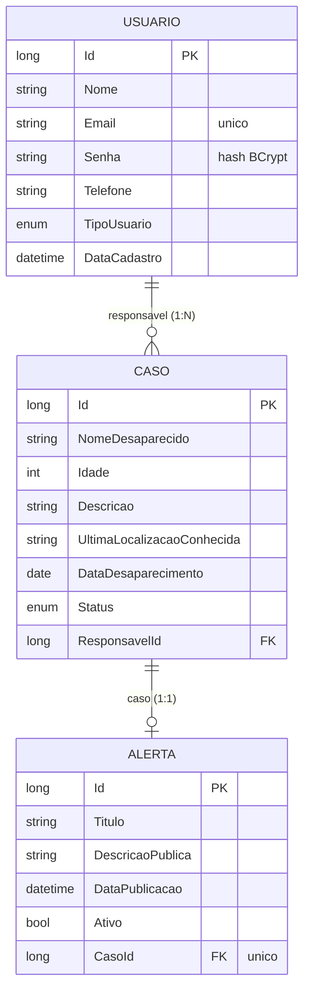

# Find Me — API REST (.NET)

API REST em **ASP.NET Core 8 (Web API) + Entity Framework Core + Oracle** que sustenta a solução **Find Me**
(CitizenTech, Global Solution 2026/2): divulgação responsável de casos de desaparecimento de crianças e
adolescentes, com validação interna antes da publicação.

Disciplina: **Advanced Business Development with .NET** — FIAP.

## Integrantes

| Nome                | RM     | Turma  |
|---------------------|--------|--------|
| Caio Couto          | 563452 | 2TDSPS |
| Guilherme Eustáquio | 566784 | 2TDSPS |
| Matheus Tavares     | 566844 | 2TDSPS |

- **Repositório:** https://github.com/caioccouto/FindMe-GlobalSoulution-DotNet.git
- **Vídeo:** <!-- TODO(VOCÊ): link do YouTube --> (preencher)

## Descrição da solução

O Find Me permite que o **responsável** por uma criança/adolescente desaparecido registre um **caso**. O caso passa por
uma validação interna (um **moderador**) e só então um **alerta público** é publicado, expondo apenas os dados
necessários para a comunidade ajudar (nome, idade, data do desaparecimento e um texto público definido pelo moderador).
Dados sensíveis (responsável, telefone, descrição privada e última localização) **nunca** aparecem no alerta.

**Relação com as outras entregas:** 
esta API é o back-end consumido pelo app Mobile (cadastro de casos e feed de alertas) e é a aplicação empacotada em
container na entrega de DevOps (a connection string entra por variável de ambiente `ConnectionStrings__Oracle`).

## Modelo de entidades



- **1:N** — `Usuario` (responsável) tem vários `Caso` (`TB_CASO.RESPONSAVEL_ID`). Usuário com casos não pode ser excluído (409).
- **1:1** — `Caso` tem no máximo um `Alerta` (`TB_ALERTA.CASO_ID` com índice único). Excluir o caso exclui o alerta.
- Tabelas no Oracle: `TB_USUARIO`, `TB_CASO`, `TB_ALERTA` (colunas em `UPPER_SNAKE_CASE`).
- Ciclo do caso: `EM_ANALISE → VALIDADO → PUBLICADO → EM_ACOMPANHAMENTO → LOCALIZADO → ENCERRADO`
  (transição inválida → **409**). `TipoUsuario`: `RESPONSAVEL`, `COLABORADOR`, `MODERADOR`.

## Como executar

### Pré-requisitos

- [.NET SDK 8](https://dotnet.microsoft.com/download/dotnet/8.0)
- Ferramenta do EF Core: `dotnet tool install --global dotnet-ef --version 8.*`
- Acesso ao Oracle da FIAP (`oracle.fiap.com.br`) — VPN/rede da FIAP, se necessário

### 1. Configurar a connection string (sem versionar a senha)

Na pasta do projeto (onde está o `FindMe.csproj`):

```bash
dotnet user-secrets set "ConnectionStrings:Oracle" "User Id=RMxxxxxx;Password=SUA_SENHA;Data Source=oracle.fiap.com.br:1521/ORCL;"
```

Troque `RMxxxxxx` e `SUA_SENHA` pelas suas credenciais. Alternativa: variável de ambiente `ConnectionStrings__Oracle`.
A senha **não** fica em nenhum arquivo do repositório.

### 2. Criar as tabelas (Migrations)

```bash
dotnet restore
dotnet ef database update
```

As migrations ficam versionadas na pasta `Migrations/`. Ao alterar o modelo:
`dotnet ef migrations add NomeDaMudanca` e depois `dotnet ef database update`.

### 3. Rodar a API

```bash
dotnet run
```

- API: `http://localhost:5080`
- Swagger UI: `http://localhost:5080/swagger`

## Como testar

Ordem sugerida (substitua os ids pelos retornados). Todos os exemplos usam `curl`; também dá para testar pelo Swagger.

```bash
# 1) Criar um usuário RESPONSAVEL -> 201
curl -i -X POST http://localhost:5080/api/usuarios -H "Content-Type: application/json" \
  -d '{"nome":"Ana Responsável","email":"ana@email.com","senha":"Senha@123","telefone":"11999990000","tipoUsuario":"RESPONSAVEL"}'

# 2) Criar um caso (responsavelId = id do passo 1) -> 201, status EM_ANALISE
curl -i -X POST http://localhost:5080/api/casos -H "Content-Type: application/json" \
  -d '{"responsavelId":1,"nomeDesaparecido":"Maria Silva","idade":12,"descricao":"Cabelo castanho, camiseta azul","ultimaLocalizacaoConhecida":"Praça central","dataDesaparecimento":"2026-11-10"}'

# 3) Listar / buscar -> 200
curl -i http://localhost:5080/api/casos
curl -i http://localhost:5080/api/casos/1
curl -i "http://localhost:5080/api/casos?status=EM_ANALISE&idadeMax=15"

# 4) Atualizar -> 204
curl -i -X PUT http://localhost:5080/api/casos/1 -H "Content-Type: application/json" \
  -d '{"nomeDesaparecido":"Maria Silva","idade":13,"descricao":"Cabelo castanho, camiseta azul","ultimaLocalizacaoConhecida":"Praça central","dataDesaparecimento":"2026-11-10"}'

# 5) Fluxo completo: validar o caso, publicar o alerta, consultar alertas
curl -i -X PATCH http://localhost:5080/api/casos/1/status -H "Content-Type: application/json" -d '{"status":"VALIDADO"}'
curl -i -X POST http://localhost:5080/api/alertas -H "Content-Type: application/json" \
  -d '{"casoId":1,"titulo":"Ajude a encontrar Maria","descricaoPublica":"Vista pela última vez na região central."}'
curl -i "http://localhost:5080/api/alertas?ativo=true"
curl -i "http://localhost:5080/api/alertas/recentes?dias=7"

# 6) Excluir -> 204
curl -i -X DELETE http://localhost:5080/api/alertas/1
curl -i -X DELETE http://localhost:5080/api/casos/1
```

### Erros tratados (todos em JSON)

```bash
# POST inválido -> 400 (lista de campos com mensagem)
curl -i -X POST http://localhost:5080/api/casos -H "Content-Type: application/json" \
  -d '{"responsavelId":1,"nomeDesaparecido":"","idade":30,"descricao":"x","ultimaLocalizacaoConhecida":"y","dataDesaparecimento":"2099-01-01"}'

# id inexistente -> 404
curl -i http://localhost:5080/api/casos/99999
```

Exemplo de 400:

```json
{
  "timestamp": "2026-11-16T12:00:00Z",
  "status": 400,
  "error": "Bad Request",
  "errors": [
    { "field": "nomeDesaparecido", "message": "nomeDesaparecido é obrigatório" },
    { "field": "idade", "message": "idade deve estar entre 0 e 17" }
  ]
}
```

## Endpoints

Cada entidade tem CRUD completo: `GET` lista, `GET` por id, `POST` (**201** + `Location`), `PUT` (**204**), `DELETE` (**204**).

| Recurso | Rotas | Extras |
|---------|-------|--------|
| Usuários | `/api/usuarios`, `/api/usuarios/{id}` | e-mail único (409); resposta nunca contém a senha |
| Casos | `/api/casos`, `/api/casos/{id}` | filtros `status`, `nome`, `idadeMin`, `idadeMax`, `dataInicio`, `dataFim`, `responsavelId`; `GET /api/casos/estatisticas`; `PATCH /api/casos/{id}/status` |
| Alertas | `/api/alertas`, `/api/alertas/{id}` | filtros `ativo`, `nome`, `idadeMin`, `idadeMax`; `GET /api/alertas/recentes?dias=7` |

| Status | Quando |
|--------|--------|
| 400 | corpo inválido/malformado, campo obrigatório ausente, valor fora da regra |
| 404 | id inexistente |
| 409 | transição de status inválida, alerta já existente para o caso, e-mail duplicado, usuário com casos |

## Fluxo de uma requisição

`Requisição HTTP → rota ([Route]/[HttpPost]...) → Controller → validação (DataAnnotations; 400 se inválido) →
FindMeDbContext (EF Core → SQL no Oracle) → resposta HTTP (200/201/204 ou erro JSON via ApiExceptionHandler)`.

## Estrutura

```
FindMe.csproj · Program.cs · appsettings.json
Controllers/   UsuariosController, CasosController, AlertasController
Models/        Usuario, Caso, Alerta, StatusCaso, TipoUsuario
Dtos/          requests (com validação) e responses
Data/          FindMeDbContext (mapeamento Oracle e relacionamentos)
Migrations/    migrations do EF Core (geradas com dotnet ef)
Exceptions/    exceções de negócio + handler que gera o JSON de erro
Validation/    DataNaoFuturaAttribute
```

## Decisões técnicas

- Mesmas 3 entidades, relacionamentos e regras da versão Java (ciclo de status, 1 alerta por caso, privacidade do alerta,
  idade 0–17). Os valores dos enums foram mantidos em MAIÚSCULAS para o contrato JSON ser idêntico ao da versão Java.
- Sem autenticação/JWT, como definido no escopo da entrega: o responsável do caso é informado no corpo (`responsavelId`).
- Senhas gravadas com **BCrypt** e nunca devolvidas pela API.
- Tabelas criadas **somente por Migrations** (nada criado à mão no Oracle).
